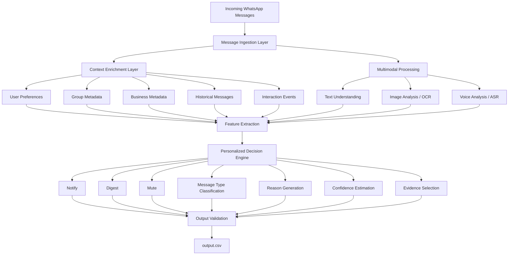
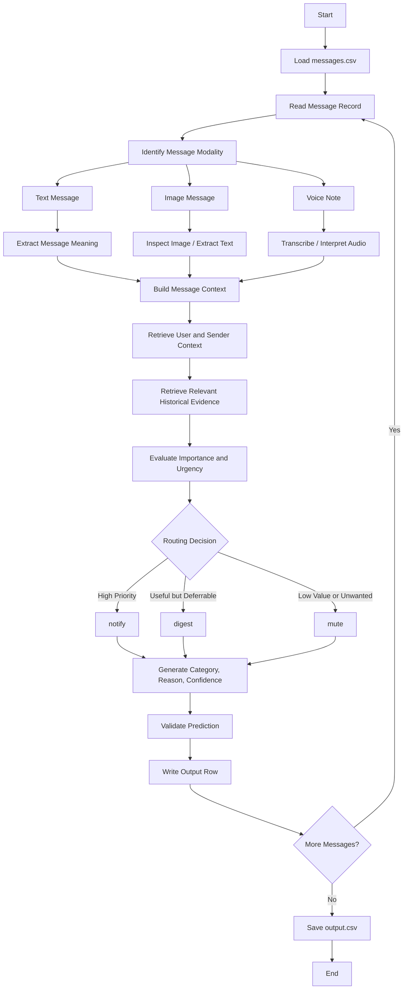
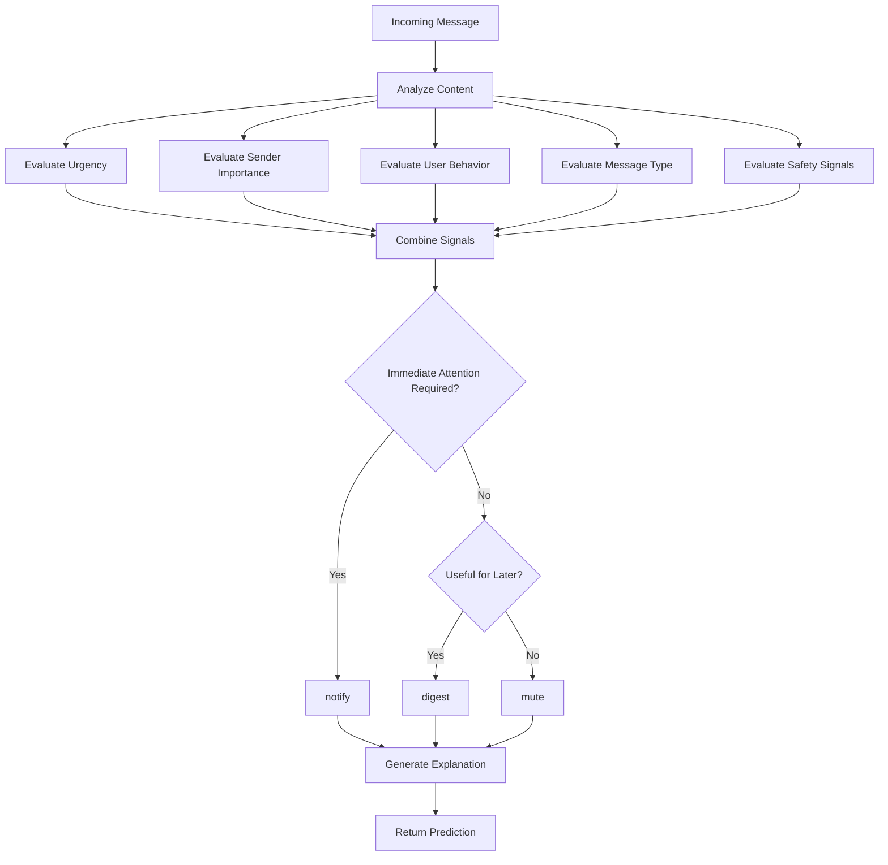
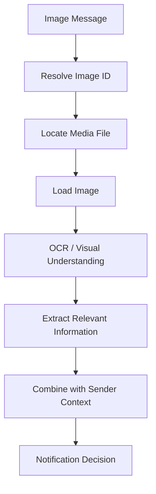
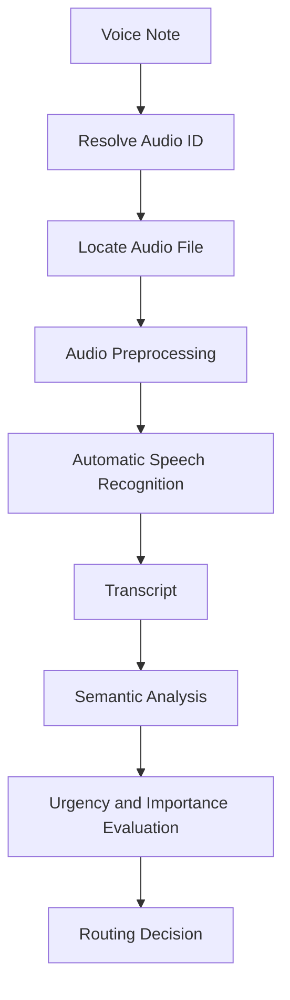
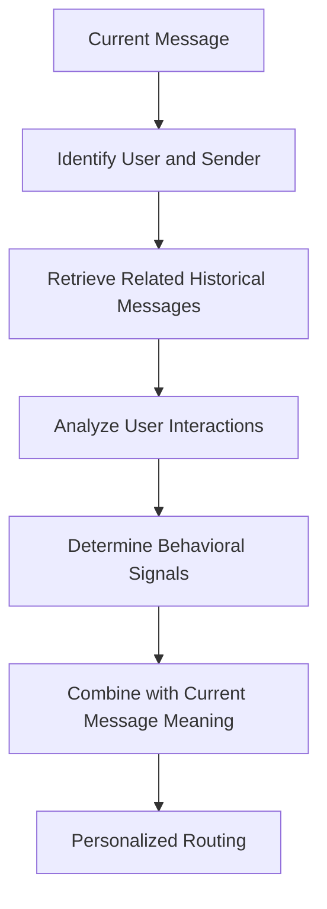
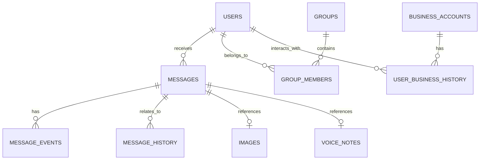
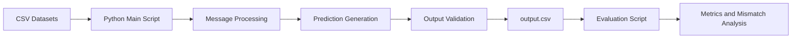
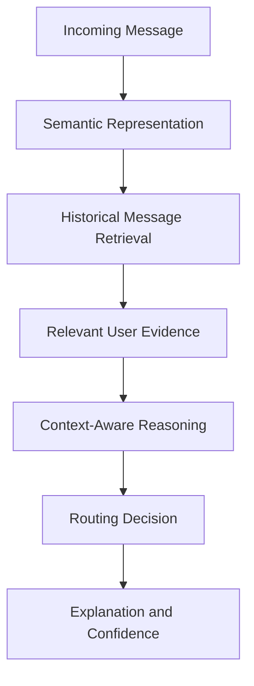

# Message Notification Router
### AI-Powered Personalized Notification Intelligence for WhatsApp

<p align="center">
  <strong>HackerRank Orchestrate — 24-Hour Hackathon</strong>
</p>

The **Message Notification Router** is an AI-powered notification management system designed to reduce notification overload by deciding which messages deserve immediate attention, which can be reviewed later, and which should be muted.

The system analyzes message content, sender context, user preferences, historical interactions, and multimodal information to generate personalized notification decisions.

Instead of treating every incoming message equally, the router aims to preserve important communication while reducing unnecessary interruptions.

---

## Table of Contents

- [1. Project Overview](#1-project-overview)
- [2. Problem Statement](#2-problem-statement)
- [3. Project Objectives](#3-project-objectives)
- [4. Proposed Solution](#4-proposed-solution)
- [5. System Architecture](#5-system-architecture)
- [6. End-to-End Workflow](#6-end-to-end-workflow)
- [7. Multimodal Intelligence](#7-multimodal-intelligence)
- [8. Personalization Engine](#8-personalization-engine)
- [9. Notification Decision Engine](#9-notification-decision-engine)
- [10. Data Architecture](#10-data-architecture)
- [11. Output Schema](#11-output-schema)
- [12. Implementation Details](#12-implementation-details)
- [13. Achievements and Evaluation](#13-achievements-and-evaluation)
- [14. Installation and Usage](#14-installation-and-usage)
- [15. Applications and Use Cases](#15-applications-and-use-cases)
- [16. Benefits](#16-benefits)
- [17. Limitations](#17-limitations)
- [18. Future Enhancements](#18-future-enhancements)
- [19. Repository Structure](#19-repository-structure)
- [20. Submission Checklist](#20-submission-checklist)
- [21. Conclusion](#21-conclusion)

---

# 1. Project Overview

Messaging applications have become essential communication platforms for personal, academic, professional, and commercial interactions. However, the continuous flow of messages creates a significant notification management problem.

A user may receive:

- Family messages and personal conversations
- College announcements and examination updates
- Workplace communication
- Society and community notices
- Business promotions and advertisements
- Image-based event posters
- Voice notes containing important information
- Spam, scams, and suspicious links

Traditional notification systems generally rely on simple settings such as contact muting, group muting, or global notification preferences.

These settings do not fully understand the importance of an individual message.

The **Message Notification Router** introduces an intelligent routing layer that evaluates each incoming message and selects an appropriate notification action.

The system produces one of three actions:

| Action | Meaning |
|---|---|
| `notify` | Deliver an immediate notification because the message may require timely attention. |
| `digest` | Defer the message and include it in a later summary. |
| `mute` | Suppress the notification because the message is low-value, unwanted, or potentially harmful. |

In addition to routing, the system predicts a message category, generates a human-readable reason, estimates confidence, and identifies relevant historical messages used as evidence.

The objective is not simply to reduce notifications. It is to **reduce unnecessary interruptions without causing important information to be missed**.

---

# 2. Problem Statement

The project addresses the challenge of intelligent notification prioritization in a noisy messaging environment.

A notification router must answer several questions for every incoming message:

1. Who sent the message?
2. What is the message communicating?
3. Is the message time-sensitive?
4. Is the sender or group important to the user?
5. Does the user usually interact with this sender?
6. Is the message a promotion, announcement, personal message, or possible scam?
7. Does the message contain relevant information in an image or voice note?
8. Should the user be interrupted immediately?
9. Can the message wait for a digest?
10. Should the notification be muted?

A reliable system must use more than message text. It should consider contextual and behavioral information while remaining consistent with the required output format.

## Core Challenge

The same message can have different importance for different users.

For example:

- A college examination announcement may be highly important to a student.
- A promotional message from an unfamiliar business may have little value.
- A family emergency may require immediate attention.
- A repeated community announcement may be useful but not urgent.
- A suspicious message asking for payment may need to be suppressed or flagged.

Therefore, notification routing should be **context-aware, user-aware, and content-aware**.

---

# 3. Project Objectives

The primary objectives are:

- Analyze incoming messages individually.
- Predict the appropriate notification action.
- Classify messages into meaningful message categories.
- Use user preferences and behavioral history for personalization.
- Process text, image, and voice-note messages.
- Use historical message interactions as supporting evidence.
- Generate short, understandable routing explanations.
- Produce confidence scores between `0` and `1`.
- Maintain valid and consistent output formatting.
- Reduce notification overload while protecting important communication.

---

# 4. Proposed Solution

The proposed solution is a hybrid notification intelligence system.

Instead of depending entirely on a single classification model, the system combines multiple information sources and decision-making stages.

The proposed pipeline includes:

1. **Message ingestion** — Read incoming messages and associated metadata.
2. **Context enrichment** — Retrieve user, group, business, and historical information.
3. **Multimodal interpretation** — Analyze text, images, and voice notes.
4. **Feature extraction** — Derive semantic, behavioral, and contextual signals.
5. **Evidence retrieval** — Identify relevant historical messages.
6. **Personalized decision engine** — Determine the notification action.
7. **Message categorization** — Predict the message type.
8. **Explanation generation** — Provide a short reason for the decision.
9. **Confidence estimation** — Estimate prediction reliability.
10. **Output generation** — Write predictions into the required CSV format.

The system is designed to be extensible. Individual stages can be improved or replaced without redesigning the entire pipeline.

---

# 5. System Architecture

## 5.1 High-Level Architecture



### Architecture Explanation

**Message Ingestion Layer**

Reads messages from `dataset/messages.csv`. Each message is associated with a unique message identifier and may contain text or references to media.

**Context Enrichment Layer**

Retrieves contextual information from supporting datasets, including user preferences, group information, business metadata, and historical interactions.

**Multimodal Processing Layer**

Interprets message content from different modalities. Text is analyzed directly, image messages can be processed using OCR or visual understanding, and voice notes can be processed using speech recognition.

**Feature Extraction Layer**

Converts the collected information into structured signals suitable for routing.

**Personalized Decision Engine**

Combines content importance, urgency, sender context, user behavior, and safety-related signals to select an action.

**Output Validation Layer**

Ensures that every prediction follows the required schema and that the generated output is suitable for evaluation.

> This is the proposed architecture. The exact behavior of each stage depends on the modules and processing methods implemented in the current codebase.

## 5.2 Architecture Design Principles

The architecture follows these principles:

- **Modularity:** Each processing stage has a distinct responsibility.
- **Context awareness:** Decisions should consider sender and conversation context.
- **Personalization:** The system should adapt to user behavior and preferences.
- **Multimodal extensibility:** Images and voice notes can be processed using dedicated components.
- **Explainability:** Predictions should include understandable reasons.
- **Evidence-based reasoning:** Historical message IDs can support relevant decisions.
- **Output consistency:** Every prediction must follow the required schema.
- **Privacy awareness:** A production implementation should minimize unnecessary data collection.

---

# 6. End-to-End Workflow

## 6.1 Message Processing Flow



## 6.2 Decision-Making Flow



The diagrams represent the intended processing flow. Individual components may be implemented using rules, machine learning models, retrieval, or a combination of these techniques.

---

# 7. Multimodal Intelligence

A major requirement of the challenge is the ability to reason over messages that are not limited to plain text.

The dataset includes image and voice-note references. These media files may contain information that is not visible in the original message text.

## 7.1 Text Message Understanding

Text messages can be analyzed for:

- Semantic meaning
- Urgency indicators
- Requests for action
- Deadlines
- Personal communication
- Announcements
- Promotional language
- Suspicious or harmful requests

Example:

> "The examination has been postponed to tomorrow. Please check the updated schedule."

This message contains an academic announcement and a potentially important time-sensitive update.

The system should evaluate the message using its content and the user's context rather than treating it as an ordinary notification.

## 7.2 Image Message Understanding

Images may contain:

- College event posters
- Examination schedules
- Meeting notices
- Payment requests
- Advertisements
- Screenshots of conversations
- Suspicious links or QR codes

A proposed image-processing pipeline is:



OCR can extract text from posters and screenshots. Visual understanding can identify additional context such as document type, layout, and relevant visual elements.

The challenge requires inspecting the media files themselves. File paths alone do not provide the content needed for classification.

## 7.3 Voice Note Understanding

Voice notes can contain urgent requests, personal communication, announcements, or irrelevant information.

A proposed voice processing flow is:



Automatic Speech Recognition (ASR) converts speech into text. The transcript can then be processed using the same semantic and contextual reasoning pipeline as a text message.

Audio quality, language, background noise, and transcription errors can affect the final prediction.

---

# 8. Personalization Engine

The same message can have different importance depending on the recipient.

The system therefore uses contextual information to make personalized decisions.

## 8.1 User Preferences

The `users.csv` dataset provides user-related information that can help determine notification behavior.

Potential personalization signals include:

- Preferred notification behavior
- User-level settings
- Notification sensitivity
- Relevant communication preferences

The exact fields available should be interpreted according to the dataset schema.

## 8.2 Group Context

The following datasets provide group-related information:

- `groups.csv`
- `group_members.csv`

Group context can help determine whether a message belongs to a college group, work group, family group, community group, or another type of conversation.

Group membership and metadata can provide useful context, but group membership alone should not automatically determine the action.

## 8.3 Business Context

Business-related datasets include:

- `business_accounts.csv`
- `user_business_history.csv`

These datasets can provide information about business senders and the user's previous interactions with them.

For example, a user who frequently interacts with a particular business may consider its messages more relevant than messages from an unfamiliar business account.

However, repeated interaction does not automatically make every message urgent.

## 8.4 Historical Interaction Analysis

Historical information is available through:

- `message_history.csv`
- `message_events.csv`
- `daily_notification_summary.csv`

These sources can provide evidence about previous messages and user reactions.

A proposed personalization flow is:



Historical evidence can help the system understand whether a user usually responds to certain senders, ignores promotional content, or engages with specific categories of messages.

The final decision should still consider the current message's content and urgency.

---

# 9. Notification Decision Engine

The decision engine maps the available signals to one of three actions.

## 9.1 Notify

The `notify` action is intended for messages that may require immediate attention.

Examples include:

- Emergency communication
- Time-sensitive requests
- Important personal messages
- Critical workplace updates
- Urgent academic announcements

The decision should be based on message meaning, context, and relevant user preferences.

## 9.2 Digest

The `digest` action is intended for messages that are useful but do not necessarily require an immediate interruption.

Examples include:

- General announcements
- Routine group updates
- Non-urgent academic notices
- Informational business messages
- Community updates

A digest can allow the user to review multiple messages together at a convenient time.

## 9.3 Mute

The `mute` action is intended for messages that are low-value, unwanted, or potentially harmful.

Examples include:

- Repetitive promotional messages
- Irrelevant advertisements
- Unwanted notifications
- Certain suspicious messages

A production system should distinguish between suppressing a notification and safely handling a potentially malicious message. Muting a message should not be interpreted as proof that it is harmless.

## 9.4 Decision Signal Overview

| Signal | Possible Influence |
|---|---|
| Message urgency | May increase immediate notification priority |
| Message meaning | Helps determine importance |
| Sender relationship | Adds personal context |
| Group metadata | Adds conversation context |
| User behavior | Helps personalize routing |
| Business history | Helps evaluate business relevance |
| Image content | May reveal hidden message information |
| Voice transcript | May reveal urgency or intent |
| Safety signals | May reduce trust or trigger additional handling |
| Historical evidence | Supports consistent predictions |

The decision engine should combine these signals rather than relying on a single keyword or sender identity.

---

# 10. Data Architecture

The project uses a collection of CSV datasets and media files.

## 10.1 Dataset Overview

| Dataset | Purpose |
|---|---|
| `messages.csv` | Incoming messages requiring predictions |
| `output.csv` | Output template for the final submission |
| `sample_messages.csv` | Solved examples for understanding expected behavior |
| `users.csv` | User-related notification preferences and context |
| `groups.csv` | Group metadata |
| `group_members.csv` | User-group relationships |
| `business_accounts.csv` | Business sender metadata |
| `user_business_history.csv` | User interactions with business accounts |
| `message_history.csv` | Historical messages |
| `message_events.csv` | Historical user reactions and events |
| `images.csv` | Image IDs and media file paths |
| `voice_notes.csv` | Voice-note IDs and media file paths |
| `daily_notification_summary.csv` | Daily notification-related context |
| `media/images/` | Image files used by messages |
| `media/audio/` | Audio files used by messages |

## 10.2 Data Relationship Overview



This diagram illustrates conceptual relationships among the datasets. The exact keys and cardinalities must follow the actual CSV schemas.

## 10.3 Data Processing Principles

A reliable implementation should:

- Preserve message identifiers.
- Avoid losing messages during joins.
- Handle missing contextual data.
- Handle missing or invalid media paths.
- Avoid using evaluation-only or organizer-only labels.
- Keep historical evidence separate from current-message predictions.
- Validate output rows before writing the final CSV.

---

# 11. Output Schema

For every message in `dataset/messages.csv`, the system produces one corresponding row in `output.csv`.

The required columns are:

| Column | Description |
|---|---|
| `message_id` | Unique identifier of the incoming message |
| `action` | `notify`, `digest`, or `mute` |
| `message_type` | Best-fit message category |
| `reason` | Short explanation for the decision |
| `confidence` | Confidence value between `0` and `1` |
| `evidence_message_ids` | Relevant historical message IDs or `none` |

## Example Output

```csv
message_id,action,message_type,reason,confidence,evidence_message_ids
msg_001,notify,personal,The message appears time-sensitive and may require immediate attention,0.91,history_014
msg_002,digest,announcement,The message contains useful information but does not appear immediately urgent,0.82,history_021
msg_003,mute,promotion,The message appears to be an irrelevant promotional notification,0.88,none
```

> The rows above are illustrative examples only. They are not actual predictions from the dataset.

## Output Validation

Before submission, the system should verify:

- The output contains every input `message_id`.
- There are no duplicate message IDs.
- The output contains the exact required columns.
- The columns appear in the correct order.
- Every action belongs to the allowed set.
- Confidence values are between `0` and `1`.
- Evidence IDs are relevant historical message IDs or `none`.
- The output file is valid CSV.

---

# 12. Implementation Details

## 12.1 Current Implementation

The current project contains a Python-based routing pipeline.

The implementation has successfully:

- Loaded the project datasets.
- Executed the main prediction script.
- Generated an `output.csv` file.
- Produced predictions for 110 messages.
- Evaluated predictions against the provided solved sample cases.
- Identified mismatches for further investigation.

The current implementation is a working baseline. The proposed architecture describes how the system can be extended into a more comprehensive multimodal and personalized notification intelligence platform.

## 12.2 Execution Pipeline



## 12.3 Technologies

The current confirmed implementation uses:

| Technology | Purpose |
|---|---|
| Python | Main programming language |
| CSV datasets | Input, contextual data, and output |
| PowerShell | Windows terminal execution |
| Python virtual environment | Dependency isolation |
| Evaluation script | Comparison against solved sample cases |

Additional technologies such as OCR, ASR, vector retrieval, transformer models, or LLM-based reasoning can be integrated into the architecture as the implementation evolves.

---

# 13. Achievements and Evaluation

## 13.1 Achievements So Far

The project has reached the following milestones:

- Established the Python execution environment.
- Located the main project script.
- Executed the routing pipeline successfully.
- Generated 110 predictions in `output.csv`.
- Confirmed the output file contains the expected columns.
- Executed the provided evaluation script.
- Identified two sample mismatches for targeted debugging.

## 13.2 Current Evaluation Results

The evaluation script reported the following results:

| Metric | Result |
|---|---:|
| Sample rows evaluated | 30 |
| Action agreement | 96.7% |
| Message type agreement | 93.3% |
| Action mismatches | 1 |
| Message type mismatches | 2 |

The observed mismatches were:

| Message ID | Expected Action | Expected Type | Predicted Action | Predicted Type |
|---|---|---|---|---|
| `sample_msg_041` | `digest` | `personal` | `digest` | `unknown` |
| `sample_msg_042` | `notify` | `urgent` | `digest` | `unknown` |

These results indicate that the current baseline is producing predictions that closely match the provided sample labels, but message-type classification and urgency handling still need improvement.

**Important:** These are sample-evaluation results, not a guarantee of performance on hidden evaluation data.

## 13.3 Current Development Focus

The next improvement stage is to investigate the two mismatches.

The focus should be on:

1. Inspecting the complete text and context of the mismatched messages.
2. Reviewing the expected message categories.
3. Identifying whether the current rules miss urgency or personal-message signals.
4. Reviewing relevant historical evidence.
5. Improving the routing logic without hardcoding sample IDs.
6. Re-running the evaluation after each change.
7. Verifying that improvements do not introduce regressions.

The goal is to improve generalization, not merely to memorize the solved examples.

---

# 14. Installation and Usage

## 14.1 Prerequisites

- Python installed on the system
- Windows PowerShell or another terminal
- Project repository cloned or downloaded
- Required Python dependencies installed

## 14.2 Project Directory

The current project directory is:

```text
C:\hackerrank_orchreate\message_notification_router\hackerrank-orchestrate-august26
```

The main Python script is located at:

```text
main_code\code\main.py
```

The requirements file is located at:

```text
main_code\code\requirements.txt
```

## 14.3 Create a Virtual Environment

From the project root:

```powershell
python -m venv .venv
```

Activate it:

```powershell
.\.venv\Scripts\Activate.ps1
```

## 14.4 Install Dependencies

```powershell
python -m pip install -r .\main_code\code\requirements.txt
```

## 14.5 Run the Prediction Pipeline

```powershell
python .\main_code\code\main.py
```

The script currently generates:

```text
output.csv
```

The output file is written to the project root.

## 14.6 Inspect the Output

Display the first ten data rows:

```powershell
Get-Content .\output.csv -TotalCount 11
```

Display the output columns:

```powershell
python -c "import pandas as pd; print(pd.read_csv('output.csv').columns.tolist())"
```

## 14.7 Run Evaluation

```powershell
python .\main_code\code\evaluation\main.py
```

The evaluation script compares the predictions against the solved sample cases and reports agreement metrics.

## 14.8 Full Execution Sequence

```powershell
# Activate environment
.\.venv\Scripts\Activate.ps1

# Install dependencies
python -m pip install -r .\main_code\code\requirements.txt

# Generate predictions
python .\main_code\code\main.py

# Evaluate predictions
python .\main_code\code\evaluation\main.py
```

---

# 15. Applications and Use Cases

The Message Notification Router can be applied to several real-world notification environments.

## 15.1 Personal Communication

Users receive messages from family members, friends, and personal contacts.

The system can prioritize time-sensitive personal communication while allowing routine messages to be reviewed later.

## 15.2 College and University Notifications

Students receive messages about:

- Examination schedules
- Assignment deadlines
- Placement drives
- Class cancellations
- Academic announcements
- Event registrations

The router can distinguish potentially urgent academic updates from routine informational messages.

## 15.3 Workplace Communication

Professionals receive messages from:

- Managers
- Project teams
- Clients
- Internal groups
- Business partners

The system can prioritize time-sensitive work communication while placing routine updates into a digest.

## 15.4 Community and Society Groups

Residential communities and local groups frequently share:

- Maintenance notices
- Water or electricity updates
- Security alerts
- Community events
- General announcements

A notification router can help separate critical alerts from repetitive group messages.

## 15.5 Business Communication

Business accounts may send:

- Order updates
- Service notifications
- Promotions
- Offers
- Appointment reminders
- Payment-related messages

The system can consider business context and previous user interactions when determining relevance.

## 15.6 Scam and Suspicious Message Awareness

Messages may contain suspicious payment requests, impersonation attempts, or misleading links.

A more advanced version of the system can use safety signals to identify suspicious content and reduce the likelihood of harmful messages being treated as trusted communication.

This functionality should be implemented carefully. Notification routing is not a substitute for a dedicated security or fraud-detection system.

## 15.7 Accessibility and Voice-Based Communication

Voice-note processing can make notification prioritization more useful for users who receive a large volume of audio messages.

Transcription and semantic analysis can help identify messages that contain important requests or deadlines.

---

# 16. Benefits

## Reduced Notification Overload

The system reduces the need for users to inspect every incoming notification individually.

## Improved Attention Management

Important messages can be prioritized while routine information is deferred.

## Personalized User Experience

Routing decisions can account for user behavior and communication context.

## Multimodal Support

The architecture supports text, images, and voice notes rather than depending exclusively on text messages.

## Explainable Predictions

The output includes a reason for each routing decision.

## Evidence-Based Decisions

Historical message IDs can be provided as supporting evidence when relevant.

## Extensible Architecture

New classifiers, retrieval methods, and multimodal models can be integrated without replacing the entire system.

---

# 17. Limitations

The current implementation is a baseline and has several areas that require further validation.

### Dataset Dependence

The quality of the predictions depends on the quality and completeness of the provided datasets.

### Multimodal Processing

Image and voice-note interpretation requires media inspection, OCR, ASR, or visual/audio models. The availability and completeness of these capabilities must be verified in the current implementation.

### Contextual Ambiguity

A message may be urgent even when it does not contain obvious urgency-related words.

### Personalization Complexity

User behavior can change over time. Historical interaction patterns may not always reflect current preferences.

### Confidence Calibration

A confidence value should represent prediction reliability. It should not simply be an arbitrary number or a direct copy of a heuristic score without validation.

### Sample Evaluation

Agreement on the provided solved examples does not guarantee the same performance on hidden evaluation data.

### Real-Time Integration

The current project processes provided datasets. Integration with a live messaging platform would require an appropriate messaging API, authentication, permissions, event handling, and privacy safeguards.

---

# 18. Future Enhancements

## 18.1 Advanced Semantic Understanding

Integrate transformer-based models or LLMs to improve the understanding of message intent, urgency, and context.

## 18.2 OCR-Based Image Understanding

Add OCR and visual analysis to interpret posters, screenshots, notices, and image-based announcements.

## 18.3 Speech Recognition

Integrate ASR for voice-note transcription and multilingual speech processing.

## 18.4 Retrieval-Augmented Personalization

Use historical messages and interaction events to retrieve relevant behavioral evidence.

A possible architecture is:



## 18.5 Confidence Calibration

Improve confidence estimation using validation data and calibration methods.

## 18.6 Real-Time Notification Service

Develop a backend service that processes messages as they arrive and returns routing decisions through an API.

## 18.7 User Feedback Loop

Allow users to correct routing decisions.

For example:

- A muted message can be marked important.
- A notification can be marked unnecessary.
- A digest message can be promoted to immediate notification.

These feedback signals can be used to improve personalization.

## 18.8 Dashboard

Develop a dashboard that displays:

- Notification distribution
- Number of immediate notifications
- Digest volume
- Muted messages
- Message categories
- User feedback
- Routing confidence
- Model evaluation metrics

## 18.9 Privacy-Aware Processing

A production implementation should minimize unnecessary data collection, protect message content, and provide transparent controls over personalization.

---

# 19. Repository Structure

The repository follows the structure below:

```text
message_notification_router/
│
├── hackerrank-orchestrate-august26/
│   │
│   ├── AGENTS.md
│   ├── README.md
│   ├── problem_statement.md
│   │
│   ├── dataset/
│   │   ├── messages.csv
│   │   ├── output.csv
│   │   ├── sample_messages.csv
│   │   ├── users.csv
│   │   ├── groups.csv
│   │   ├── group_members.csv
│   │   ├── business_accounts.csv
│   │   ├── user_business_history.csv
│   │   ├── message_history.csv
│   │   ├── message_events.csv
│   │   ├── images.csv
│   │   ├── voice_notes.csv
│   │   ├── daily_notification_summary.csv
│   │   │
│   │   └── media/
│   │       ├── images/
│   │       └── audio/
│   │
│   └── main_code/
│       ├── README.md
│       └── code/
│           ├── main.py
│           ├── requirements.txt
│           │
│           └── evaluation/
│               └── main.py
│
└── .gitignore
```

The `.venv/` directory contains the local Python environment and should generally not be included in the submission ZIP or GitHub repository.

The repository may contain additional files depending on the final implementation.

---

# 20. Submission Checklist

Before submitting the project to HackerRank, verify the following:

- [ ] The prediction script runs from the terminal.
- [ ] The script reads the provided datasets.
- [ ] Every input message receives one prediction.
- [ ] No input message is accidentally omitted.
- [ ] No message ID appears more than once in the output.
- [ ] The output contains the exact required columns.
- [ ] The columns are in the required order.
- [ ] All actions are valid.
- [ ] Confidence values are between `0` and `1`.
- [ ] Evidence IDs refer to relevant historical messages.
- [ ] The evaluation script has been executed.
- [ ] The final `output.csv` has been regenerated after the last code change.
- [ ] The README includes accurate setup and execution instructions.
- [ ] The code ZIP includes the runnable implementation and required configuration.
- [ ] The chat transcript `log.txt` has been prepared according to the repository instructions.
- [ ] No API keys, passwords, or secrets are included in the submission.

---

# 21. Conclusion

The **Message Notification Router** aims to transform notification management from a simple delivery mechanism into an intelligent, personalized attention-management system.

By combining message understanding, contextual information, behavioral signals, historical evidence, and multimodal processing, the proposed architecture can make more meaningful notification decisions.

The current implementation has successfully generated predictions and completed an initial sample evaluation. The next development stage focuses on improving message categorization, urgency detection, multimodal interpretation, personalization, and confidence calibration.

The long-term vision is a notification intelligence layer that helps users focus on what matters while reducing unnecessary interruptions.

**The central principle of the project is simple:**

> Not every message deserves an interruption, but every important message deserves attention.
